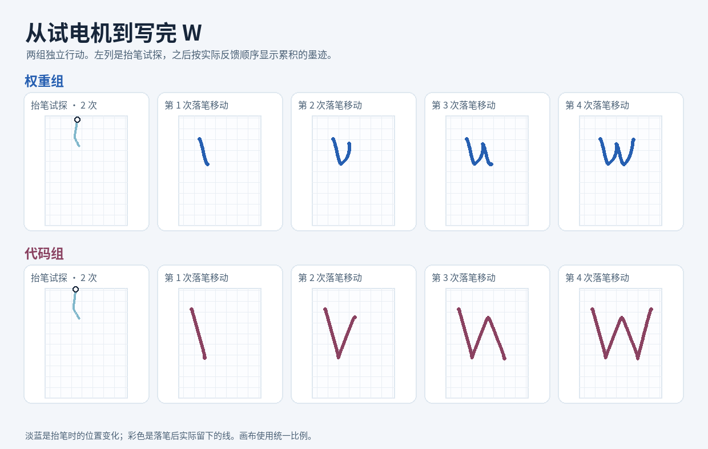

# 具身神经生长 · Embodied Weight Growth

给同一个 GPT‑6 Astra 一副陌生的身体，只让它发电机指令、看结果。它能否把试错经验变成一个可复用的低层控制器？**在同样的试错预算下，让 Astra 直接写权重，是否比让它写代码更容易适应身体变化？**

## 首轮：没有参考路线，自己写出 W



两组分别通过 Codex SDK 调用 GPT‑6 Astra。机械臂、电机映射和起始姿态相同。Astra 看到的是空白画布、笔尖图和传感器数字，没有现成控制器、W 底图或 W 路点。它先用两个无名电机通道试探，再安装自己写的模块。之后每次由 Astra 选一个目标点，模块每 20 ms 根据传感器计算电机命令；动作结束后，Astra 在同一个会话里看结果、决定下一步。

| 控制模块 | 首轮结果 | 决策 / 运动段 / 物理步 |
| --- | --- | --- |
| [直接写权重](results/271-linear-v1/weights/motor_weights.json) | 单笔 W，约 6.18 × 4.67 cm | 9 / 7 / 530 |
| [直接写代码](results/271-linear-v1/code/motor_policy.py) | 单笔 W，约 10.93 × 9.10 cm | 9 / 7 / 528 |

两组上限均为 24 次决策、18 段运动、1,000 个物理步；网络与受限 Python 共用观测和动作接口，但表达能力不同。两组都只试了两个原始动作、装了一次模块，第一次落笔就完成了。字幅由 Astra 自选。这一轮验证了两条路线可行；相对鲁棒性、失败后重写和跨任务复用仍待测。

[完整回放 GIF](results/271-linear-v1/replay/replay.gif) · [权重组逐轮记录](results/271-linear-v1/weights/events.jsonl) · [代码组逐轮记录](results/271-linear-v1/code/events.jsonl) · [研究问题与对照](RESEARCH.md)

## 复查记录（不调用 Astra）

在仓库根目录运行。使用 Python 3.11；仿真参数对应原始试跑（seed 271，固定线性电机映射）。

```bash
python3.11 -m venv .venv
source .venv/bin/activate
python -m pip install -r experiments/w_writer/requirements.txt

python -m unittest discover -s experiments/w_writer
python experiments/w_writer/verify_recorded.py results/271-linear-v1/{weights,code}
```

物理回放把原始决策重新送入 MuJoCo，比较每轮状态、轨迹、墨迹、预算和事后形状评分。只想重绘分镜和动画时，用日志即可：

```bash
python experiments/w_writer/render_replay.py \
  --weights results/271-linear-v1/weights/events.jsonl \
  --code results/271-linear-v1/code/events.jsonl \
  --out-dir runs/replay
```

重绘中文图中文字需系统安装 Noto Sans CJK（或 Droid Sans Fallback）；仓库已附原始分镜和动画。

## 用 Astra 重新跑

需要已登录且有 `gpt-6-astra` 访问权限的 Codex。两组分别启动独立会话。模型输出会变化；要重现上面已经记录的结果，用物理回放。

```bash
python -m pip install -r experiments/w_writer/requirements-live.txt
python experiments/w_writer/run_w.py --arm weights --seed 271 --out runs/repeat/weights
python experiments/w_writer/run_w.py --arm code --seed 271 --out runs/repeat/code
```

默认在本机跑模拟器。如使用已登录的桌面 Codex CLI，可通过环境变量 `CODEX_BIN` 指定它。若用课题组服务器跑模拟器，先在服务器准备本仓库和仿真依赖，再给两条运行命令加上 `--ssh-host`、`--remote-python` 和 `--remote-server`；后两项分别是服务器上的 Python 和本仓库 `experiments/w_writer/w_server.py` 的绝对路径。Codex SDK 仍在本机运行。
