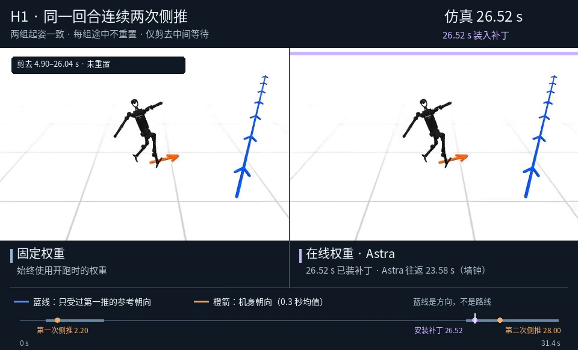

# 具身神经生长 · Embodied Weight Growth

**[打开实验回放图库 →](https://siddhartha-yz.github.io/embodied-weight-growth/)**　·　[研究问题与对照设计](RESEARCH.md)

同样的机器人、反馈和试错预算，GPT‑6 Astra 把经验写进权重，还是写成代码？我们从不提供 W 路线的两连杆机械臂开始，逐步做到双足行走、连续侧推和双臂抓放。这里保留实录、源码和逐局结果，包括没修好的实验。

## 先看两组画面

**LIBERO 抓放。** 同一个起姿、同一个酒瓶目标。原策略抬错了碗；第 13 层激活干预没抬起东西；只改措辞抬对了酒瓶，但三组都没上柜。[播放](https://siddhartha-yz.github.io/embodied-weight-growth/#libero) · [实验记录](experiments/libero_goal/README.md)

**H1 连续侧推。** 机器人边走边等 Astra，新权重赶在第二推前装入。在线组仍摔倒，固定组没倒，但两组都没达到完整恢复判据。[播放](https://siddhartha-yz.github.io/embodied-weight-growth/#h1) · [五组 H1 实验](experiments/humanoidbench/README.md)

## 全部实验

| 实验 | 看什么 |
| --- | --- |
| [两连杆电机校准](experiments/body_calibration/README.md) | Astra 写权重与数值拟合的实测轨迹 |
| [机械臂写 W](experiments/w_writer/README.md) | 从试探电机、写模块到落笔；可重放原始决策 |
| [推方块进窄槽](experiments/slot_push/README.md) | 每次推完的反馈、控制模块、换角度复用 |
| [Walker2d 从零行走](experiments/walk/README.md) | 冻结代码和权重 v8；数值编译及蒸馏对照 |
| [Walker2d 权重手术与在线 BP](experiments/walker2d_adaptation/README.md) | 从直接编辑到激活定位，比较救援与保留原步态 |
| [PhysEvo 同题试跑](experiments/physevo_wsp/README.md) · [PyRUA-RSI](experiments/pyrua_rsi/README.md) | 数字搬运的权重、代码重建与原生环境校验 |
| [EmbodiedEvo 排 7310](experiments/embodied_evo_digits/README.md) | 作者框架；同布局、同 1,050 步，有无继承技能各一局 |
| [HumanoidBench H1](experiments/humanoidbench/README.md) | 从零、预训练补丁、同触发同限幅、异步和连续侧推 |
| [LIBERO-Goal / SmolVLA](experiments/libero_goal/README.md) | 换物体位置、干预内部激活、改提示和分阶段对照 |

视频里的“回放”包括原生相机录像，以及按实测轨迹或逐轮图像重绘的对照；各实验页分别标注。第三方框架和大型权重由原项目分发。
