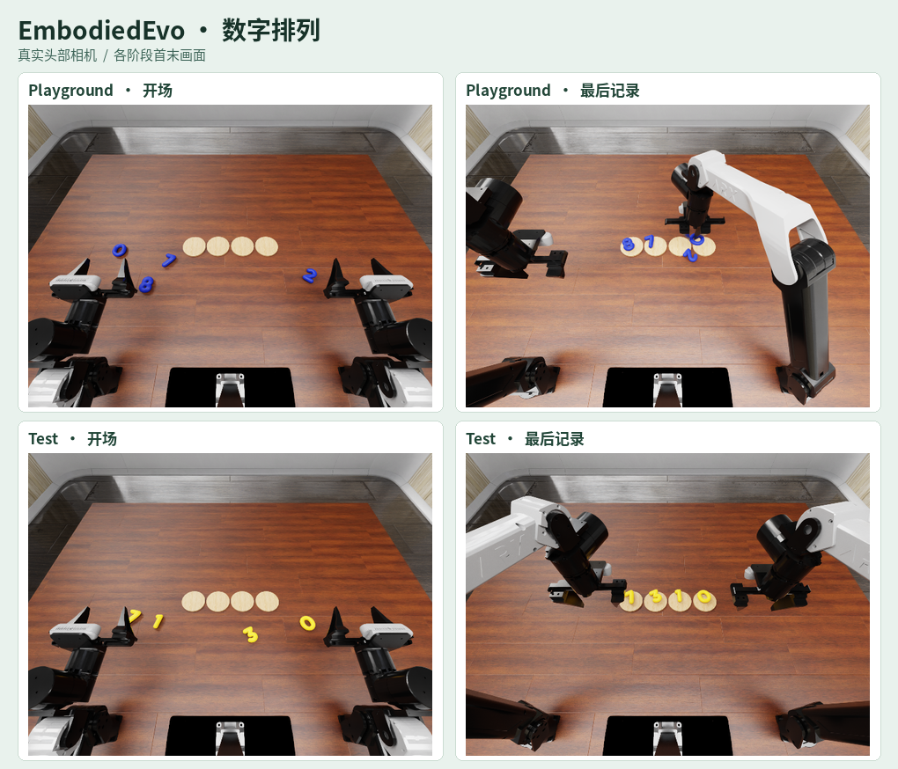

# EmbodiedEvo · 7310 的两局对照

[练习场回放](media/playground.mp4) · [带冻结技能](media/frozen-skill.mp4) · [新会话、无技能](media/no-skill.mp4) · [原生结果摘要](results/summary.json)

用 [EmbodiedEvo 作者框架](https://github.com/Einsia/EmbodiedEvo)（提交 `689a09b4`）的 RoboDojo 任务，Codex SDK 调 GPT-6 Astra。练习场不给现成技能，Astra 试错后留下代码与笔记。两个测试会话都是新开的，同一个标准布局（bank 0 / layout 1，seed 1），各限 1,050 原生步，只有一个会话带入冻结技能与笔记。

| 7310 测试 | 按原生判据放对 | 原生分 | 通过 |
| --- | ---: | ---: | --- |
| 带冻结技能与笔记 | 4/4 | 30/100 | 否 |
| 无技能与笔记 | 3/4 | 30/100 | 否 |

带技能的一局四枚数字的位置和朝向都合格，但双臂没有按原生要求归位，分数封顶为 30。无技能的一局只有三枚合格，也未归位。单个布局无法估计技能继承的普遍收益。这是代码路线对照；没有并入作者框架或任务资产。
