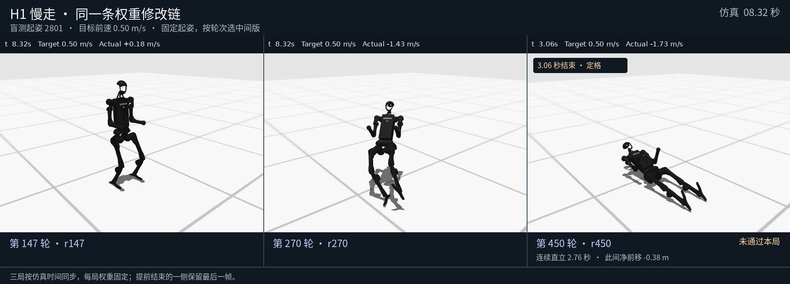
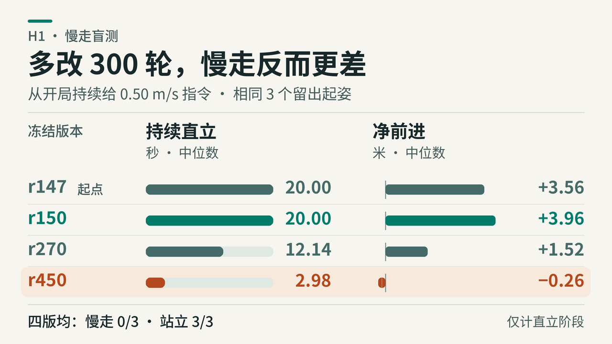

# H1：从零站稳，450 轮后仍没学会慢走

[在回放图库播放同起姿对照 →](https://siddhartha-yz.github.io/embodied-weight-growth/#h1-curriculum) · [复测方法](REPRODUCE.md) · [历史盲测逐局结果](results/heldout.json)

GPT‑6 Astra 从零写出能站稳 20 秒的数值控制器，再用实测反馈修订同一张网。**450 轮自选试验后，站立仍通过 3/3，慢走仍是 0/3。** 中途 r150 在三局慢走测试中有两局撑满 20 秒，计分段前速约 0.20 m/s；目标是 0.50 m/s。到 r450，三局都在 4 秒内失稳。更多修订没有换来更好的步态。

上方录像在同一个留出起姿 2801 上对齐三版的仿真时间，按原始物理轨迹渲染。提前结束的一栏保留最后一帧，不表示机器人还在继续执行。

## 同一张网，不给步态

使用无手版 HumanoidBench `h1-walk-v0`。策略每 0.02 秒读取 61 项身体观测与目标速度输入（目标速度是其中一项），经最多 32 个 tanh 隐藏单元与输入直连，给 19 个关节输出归一化位置目标。站立与走路都用这张网，不输入时钟或任务标签，也不提供示范、预训练步态、外置振荡器或梯度更新。Astra 通过 Codex SDK 写绝对系数；每个仿真回合的权重不变。

- **先从零学站立。** r05 在三个留出起姿站立全过。早期另试了从零慢走、从站立继承慢走各 10 轮，再做 4 轮站走联合修订；这些支线都没通过慢走，联合分支的留出启停也是 0/3。
- **固定试法：30 轮。** 从站立 r05 出发，每轮在三个开发起姿固定跑慢走和站立；只把慢走反馈给编辑器。180 个开发回合，39,817 个原生控制步。第 10、20、30 轮的慢走、站立盲测都为 0/3。
- **自选试法：30 + 117 + 303 轮。** 另从 r05 起跑。Astra 每轮给出假设、判读方式和 1–3 局试验，可选开发起姿以及限时或接触触发的速度段。只用实跑后的这一版继续，不回退到最佳版。三个独立会话顺序继承 r30、r147，分别完成 90、351、909 个开发回合；留出结果不回传。首段自选分支的站立保留好于固定分支，但自选分支也能主动拿到站立反馈；两种设定各只有一条链。

第一次续跑在 r148 的试验计划两次校验失败后停在 r147：一局超过 20 秒，重交时又给了四局。修过流程后，r345 再交四局时，只重交计划，不重写已校验的权重；这一轮最终完成。[两次拒收与一次补交的数值证据](results/plan-repair.json)

## 历史盲测：能前移，仍没通过慢走

三种起姿由预先固定的种子 2801–2803 产生，站立从零速起跑，慢走从第一步持续要求 0.50 m/s，最长 20 秒。合格落脚须有至少 80 ms 腾空、1.2 cm 离地和 3.5 cm 向前摆幅；完整慢走还要求不倒、速度达标、横向速度受限，且计分段内至少六个连续交替落脚。直立时间、位移和下表最长序列只看首次持续失稳前；向前摔不算走路。

| 冻结版本 | 站立通过 | 慢走通过 | 慢走直立时间中位数 | 失稳前最长交替落脚（逐起姿） |
| --- | ---: | ---: | ---: | --- |
| [站立 r05](weights/standing-r05.json) | 3/3 | 0/3 | 20.00 s | 0 / 0 / 0 |
| [固定 r30](weights/fixed-r30.json) | 0/3 | 0/3 | 2.50 s | 0 / 0 / 0 |
| [自选 r30](weights/adaptive-r30.json) | 3/3 | 0/3 | 4.70 s | 0 / 0 / 0 |
| [自选 r60](weights/adaptive-r60.json) | 3/3 | 0/3 | 3.06 s | 0 / 5 / 0 |
| [自选 r90](weights/adaptive-r90.json) | 3/3 | 0/3 | 13.56 s | 2 / 1 / 4 |
| [自选 r147](weights/adaptive-r147.json) | 3/3 | 0/3 | 20.00 s | 3 / 0 / 1 |
| [自选 r150](weights/adaptive-r150.json) | 3/3 | 0/3 | 20.00 s | 4 / 0 / 4 |
| [自选 r270](weights/adaptive-r270.json) | 3/3 | 0/3 | 12.14 s | 2 / 3 / 3 |
| [自选 r450](weights/adaptive-r450.json) | 3/3 | 0/3 | 2.98 s | 2 / 0 / 1 |

[早期自选探针录像：r30 的两次合格落脚](media/probe-r30-trial-1.mp4)。这是开发局，不是盲测：渐进提速后出现左、右两次有效落脚，但之后仍摔倒。相同权重在三局慢走盲测没有合格落脚。

## 退化发生在哪里

- **在开发条件里就退化了。** r148–r450 的 303 轮中，从开局就给 0.50 m/s 的试法始终用同一个起姿（273），且第 7 秒就改为零速；没有一轮从开局持续走满 20 秒。这个 7 秒段本身也越撑越差：r200–r249 有 40/50 轮撑满，r400–r450 只有 14/51。
- **某一组系数救了一个场景，也能伤到另一个。** r441→r442 只改了四个镜像髋系数，指令和开发起姿不变。两个先站再走的起姿从约 5–6 秒升到约 13 秒，最长交替落脚由 2 升到 6；从开局就走的起姿反而从 3.64 秒跌到 2.94 秒。
- **双踝更早失去调整余量。** 在 r150 两条完整存档轨迹的同一组身体状态上，只重算动作，不推进仿真。以起姿 2801 为例，两只脚踝同时顶到各自动作限幅的比例是 r150 **8.4%**、r270 **23.1%**、r450 **29.2%**。这是同状态下的动作差异，不能单独归因到某个系数或证明它造成了全部跌倒。[`audit.py --ankles` 可复核](REPRODUCE.md#离线核对参数与踝关节限幅)
- **这条链没用满网络，也没有单独测出容量上限。** r150–r450 始终使用同样的 10 个隐藏单元，300 轮实际动过 114 个不同的系数（重复计数 1,522 次），每轮 2–8 个。r150 有 143 个非零系数，r450 有 161 个；网络最多可用 3,770 个标量参数。下一步可固定同一 20 秒开发任务，从 r150 只优化原有 143 个非零项；若能过，就无需扩大这套稀疏结构。该对照尚未执行。

## 数据与代码

[原始站立及短支线](results/initial-rounds.jsonl) · [固定 30 轮](results/fixed-rounds.jsonl) · [自选 450 轮](results/adaptive-rounds.jsonl) · [逐局冻结结果](results/heldout.json) · [复测与离线审计](REPRODUCE.md)

每行轮次记录包含父版本、数值提案和开发测量；自选轮还包含实际执行的试验计划。公开后，若要做新盲测，应另选留出起姿。
