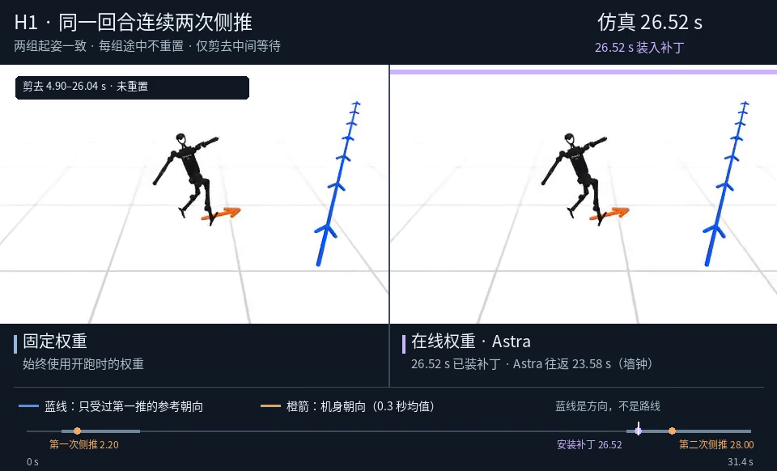
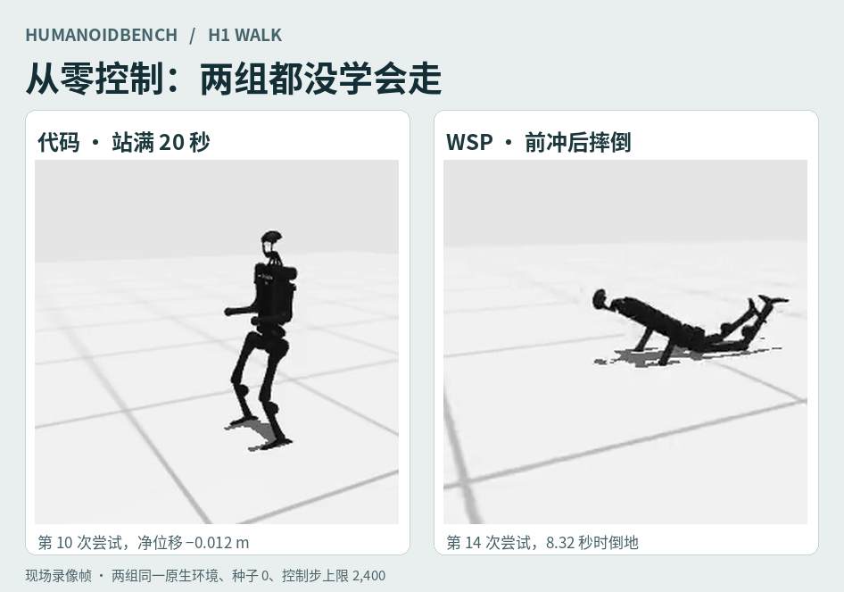
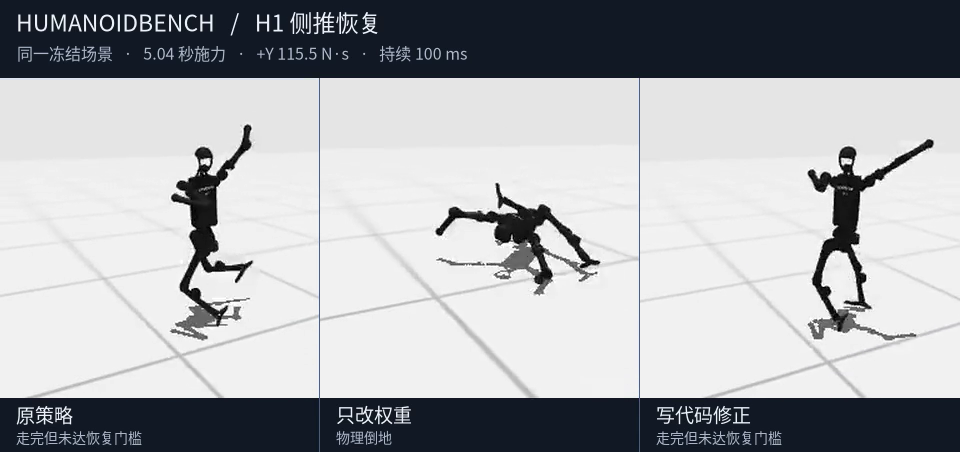
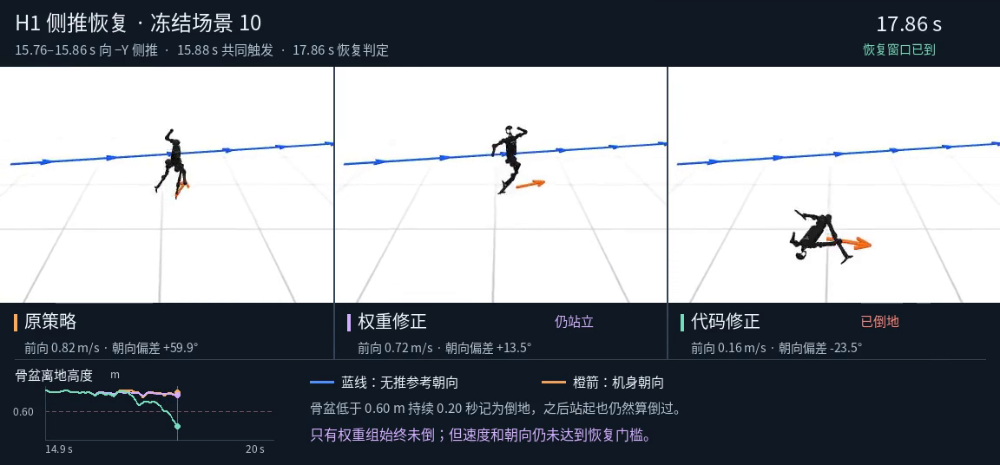
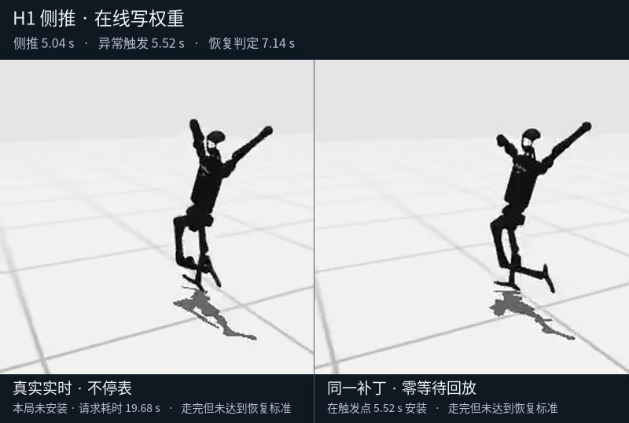
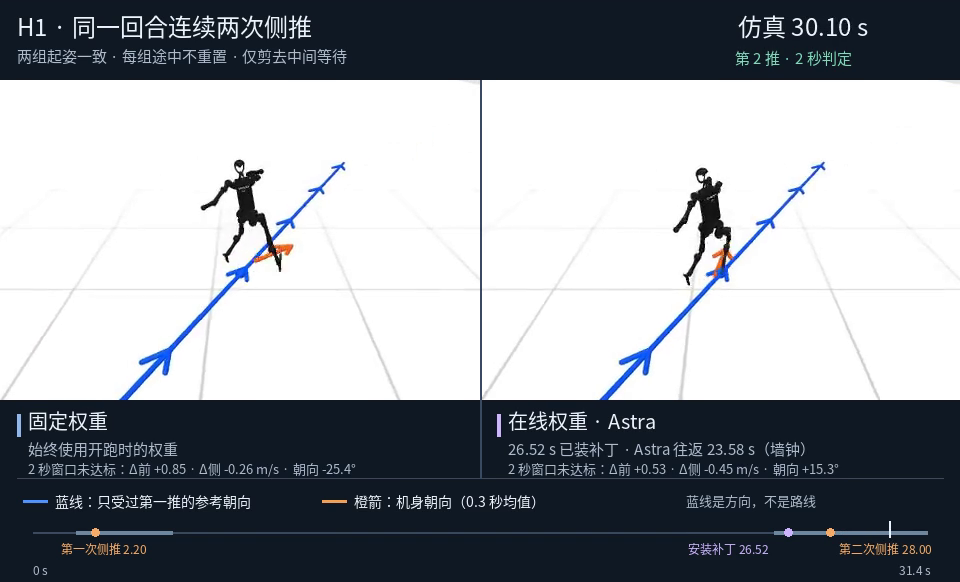

# HumanoidBench H1：写代码、改权重、边走边改

**一次实验证明了换权重可以在行走中发生，却没有证明换进去的补丁能救场。** 双推试跑中，6Astra 返回的补丁在第二推前 1.48 秒装上；仿真没暂停、没重置。第二推后，在线组的前向速度和朝向误差更小，但侧向误差更大，最终倒地；固定组没倒。上图点开看这一局。

另见 [H1 从站立到慢走](../h1_curriculum/README.md)：不用预训练步态，从站立 r05 自选试法、直接写权重到 r450，配有同起姿盲测曲线和录像。

| 实验 | 看录像 | 读结果 |
|---|---|---|
| 从零写代码 / 写数值权重 | [代码](zero/h1-zero-code.mp4) · [WSP](zero/h1-zero-wsp.mp4) · [第 11 版延长验证](zero/h1-zero-wsp-r011.mp4) | 两组都没学会走；代码组能站 20 秒 |
| 已训练 H1：冻结补丁对照 | [第 1 局](trained-push/h1-frozen-push-case01.mp4) · [第 11 局](trained-push/h1-frozen-push-case11.mp4) | 12 局中，只有代码组 1 局达到完整恢复 |
| 同触发、同物理动作限幅 | [第 10 局](matched/h1-matched-case10.mp4) · [第 11 局](matched/h1-matched-case11.mp4) | WSP 在第 10 局单独保住不倒，没达到完整恢复 |
| 一推后异步写权重 | [实时 vs 同补丁即时回放](live/h1-live-case01.mp4) | 回复来得太晚；即时回放也未达到完整恢复 |
| 同一局连续两推 | [固定补丁 vs 在线更新](two-push/h1-two-push.mp4) | 在线换入成功，第二推后仍倒地 |

## 1 · 从零：代码组站住了，两个组都没走起来

两组用同一个原生 `h1-walk-v0`、种子 0、每组 2,400 个控制步上限，从空白开始。代码组提交 20 次、试 11 次，花约 308 秒；权重组提交 21 次、安装 18 版数值策略、试 15 次，花约 573 秒。代码组第 10 次在原地站满 20 秒（净位移 −0.012 m）；没有持续行走。WSP 第 11 版在 4 秒内前移 0.257 m，但朝向已偏约 28°；把同一版跑长，4.98 秒时摔倒。不要把倒地时的位移算成步态。

[代码结果](zero/code-results.json) · [WSP 结果](zero/wsp-results.json) · [延长验证](zero/rev011-verification.json) · [冻结代码技能](zero/skills/) · [18 版数值策略](zero/weights/) · [两组实现](zero/source/)

## 2 · 已训练基座：不倒和恢复是两件事

三组共享 [DR.Q 的 H1 检查点](https://huggingface.co/dmux/DR.Q/tree/d31f529b9eef3999f353498a9cb66c35eb8021b2/DRQ%2BHBench-h1-walk-v0%2B0)。修复组分别由新的 6Astra 会话提出权重补丁和代码残差，不用梯度或教师动作。冻结后测 12 次侧推。推完 2 秒时，前向和侧向速度差须分别不超过 0.20 / 0.15 m/s、朝向差不超过 10°，参照同种子、同一时刻无推的原策略；还得走满 20 秒且没倒。

| 冻结策略 | 达到恢复 | 走满没倒 |
|---|---:|---:|
| 原策略 | 0/12 | 10/12 |
| 改权重 | 0/12 | 8/12 |
| 写代码 | 1/12 | 10/12 |

第 1 局的三组都没恢复。第 11 局是代码达标的那一局，[录像](trained-push/h1-frozen-push-case11.mp4)是相同冻结场景的复跑视角，蓝线画无推参考的朝向，不是规定路线。原冻结补丁从起步就生效，导致 WSP 在 7/12 局受推时的支撑状态已经与原策略不同；下一组对照专门消除了触发前的差异。

[12 局和无推统计](trained-push/summary.json) · [逐局 CSV](trained-push/paired.csv) · [冻结场景](trained-push/calibrated/plan.json) · [权重补丁](trained-push/run/wsp/selected.json) · [代码残差](trained-push/run/code/selected.py) · [实现](trained-push/source/)

## 3 · 同触发、同限幅：WSP 少倒一局，代码仍是唯一完整恢复

复测同一批 12 局，不重新选参数。两组从**同一个实际观测和动作前缀**开始修正，窗口都是 1 秒，末 0.3 秒淡出，实际关节目标角向量共用 0.14595 rad（8.36°）L2 上限。12 局有 11 局触发。原策略、WSP、代码分别有 **10/12、11/12、10/12** 走满未倒；完整恢复分别为 **0/12、0/12、1/12**。

第 10 局只有 WSP 保住不倒，但 2 秒时比无推参考慢 0.86 m/s，朝向还差 13.48°。第 11 局 WSP 朝向误差仅 1.91°，速度没同时过线。触发局实际关节目标修正 RMS 的中位数是 WSP 2.89°、代码 6.22°；等上限不等于每步动作同样大。录像按已记录状态重渲染。

[逐局指标](matched/cases.json) · [配对汇总](matched/comparison.json) · [第 10 局触地核对](matched/case10-contact-notes.md) · [实现](matched/source/)

## 4 · 单次在线：回复迟到；即时回放也没救回来

仿真跟墙钟同步推进，不等 Astra。三次侧推中，两次由本体观测触发请求；有效回复分别耗时 19.68、21.29 秒，均晚于 20 秒回合结束，**实时组没有装上补丁**。第三局未触发。即时回放从完全相同的异常观测装同一个补丁，动作确实改变，仍都没达到恢复门槛。额外一次低推理强度的第 1 局回复耗时 17.88 秒，也在结束后才到。

[时间记录](live/timing.json) · [有效补丁](live/valid-patches.json) · [低推理强度复跑](live/low-effort.json) · [实现](live/source/)

## 5 · 连续双推：真的换进去了，第二推后还是倒了

同一局在 2.20 / 28.00 秒沿 +Y 施加相同的 100 ms 脉冲。两组起步用同一个冻结补丁；在线组在 2.92 秒异步请求，墙钟往返 23.58 秒，于 **26.52 秒**换入两条髋滚转连接的权重差分。安装前两组逐步一致。仿真未暂停、未重置、未错过原生控制周期。

| 第二推后两秒，和同种子只受第一推的参考相比 | 固定补丁 | 在线更新 |
|---|---:|---:|
| 前向速度误差绝对值 | 0.847 m/s | 0.526 m/s |
| 侧向速度误差绝对值 | 0.264 m/s | 0.445 m/s |
| 朝向误差绝对值 | 25.37° | 15.27° |
| 走到结尾没倒 | 是 | 否 |

在线组在 31.34 秒触发原生跌倒，固定组走满 31.40 秒。两组都没完全恢复。这是一局先经固定组校准的配对试跑。录像为密集控制记录的离线重渲染节选，保留时标，未参与在线控制。

[时间和指标](two-push/result.json) · [固定组校准](two-push/calibration.json) · [实现](two-push/source/)

## 源码和复现边界

- 仿真为 [HumanoidBench `cb11890`](https://github.com/carlosferrazza/humanoid-bench/tree/cb1189039151c8aadaaa987b442da54383c87fab)。从零实验用原生 51 维状态、19 个归一化关节位置目标和 50 Hz；预训练 DR.Q 按原设定 25 Hz 更新动作，每个动作在原生环境保持两步。
- 从零实验是 [EmbodiedEvo](https://github.com/Einsia/EmbodiedEvo) 会话接口的适配，不是该框架在 H1 的官方成绩。公共包含我们的适配器、任务配置和 SDK 桥，不包含上游框架、机器人资产或第三方模型。
- 权重候选由 Codex SDK 调用 6Astra 直接写出，不做 BP。实时统计和录像时轴中的仿真秒、墙钟秒分开。
- [复现入口](REPRODUCE.md) 列出依赖、冻结场景、数值补丁、运行方式与未归档内容。
