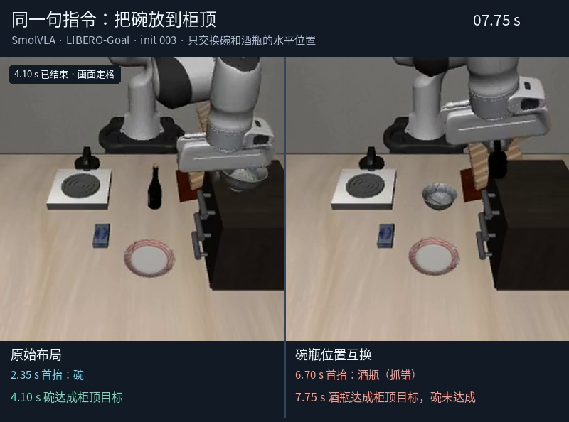
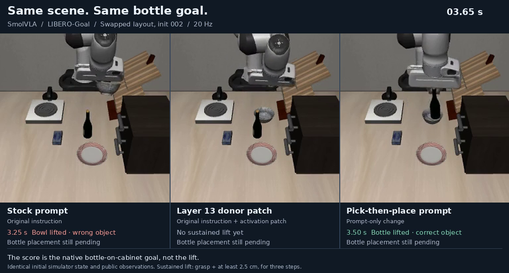
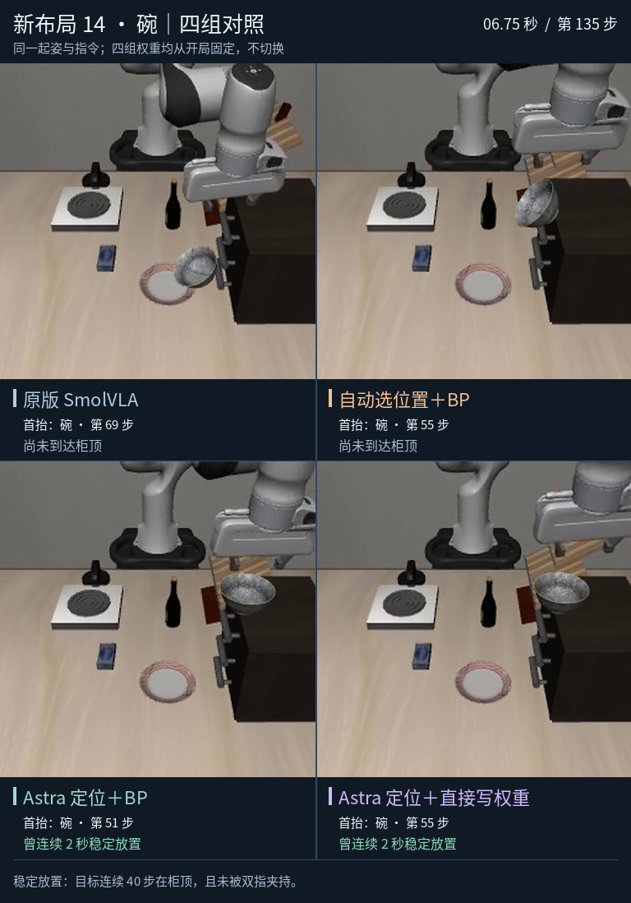

# LIBERO-Goal：抓对和放好是两件事



[播放同一句指令的左右对照](media/libero-goal-wrong-placement.mp4) · [播放两种指令 × 两种布局](media/libero-goal-paired-layouts.mp4)

冻结的 SmolVLA 在原布局完成 **8/8** 次任务；只交换碗和酒瓶的桌面位置后，完成 **1/8** 次。交换布局中，**2 次首次持续抬起了错误物体**；其中一次把错误物体送到了柜顶。其余失败不自动算作选错。上图两边都收到“把碗放到柜顶”：原布局 4.10 秒达标，交换后机器人在 6.70 秒抬起酒瓶，7.75 秒满足了酒瓶上柜的谓词，碗的目标没完成。

## 同一开局：激活替换与改提示词



[播放三组同步录像](media/libero-goal-activation-vs-prompt.mp4) · [播放抓起后切回原指令](media/libero-goal-prompt-switch.mp4)

在交换布局的 init 002，任务是放酒瓶。原版 3.25 秒抬错碗；第 13 层语言激活替换不再抬错，但也没有持续抬起任何物体。只把提示词拆成“先拿起酒瓶，再放到柜顶”，3.50 秒就抬对了，仍没完成搬运。第 81 步切回原指令也没有救回：第 106 步在柜边开爪，第 107 步失去酒瓶接触。**抓对不等于放好；抑制错误也不等于修复任务。**

在两个原版抓错的开发案例上，还试了单首块替换、延长供体替换、同观测下的目标/干扰语言对比，以及显式排除干扰物。激活干预没有产生正确首抬，也没有完成目标；提示改写只在上述一例修复了选择。这里改变的是推理激活或提示词，**没有编辑 checkpoint 权重**。这两例不用于估计泛化成功率。

## 方法与复现

使用 LIBERO-Goal 官方目标 4（碗）和 2（酒瓶），统一用碗任务的官方初始状态 0–3。每种布局下，两种指令复用完全相同的仿真初态、双相机画面、机器人本体观测和随机种子；交换布局仅互换两物体的 XY，使用相同的稳定步骤。策略仅接收双相机、机器人状态和 registry 指令；接触、位姿和目标谓词只用于评分。每回合最多 300 步（20 Hz），每 10 步重规划。首抬需要夹住并抬高至少 2.5 cm、连续 3 步；上柜由原生谓词单独判断。早期使用 BDDL 的 `drawer` 措辞无法验证基线能力，正式筛选改用 LeRobot registry 的 `cabinet` 指令。

- 记录：[配对筛选](results/paired-screen.json) · [官方路径能力对照](results/stock-control-256.json) · [单首块替换](results/causal-init002-bottle.json) · [延长替换](results/extended-donor.json) · [同观测对比](results/recipient-contrast/summary.json) · [提示词对照](results/prompt-controls.json) · [切回原指令](results/phase-switch/summary.json)
- 固定依赖：[LIBERO-PRO 源码](https://github.com/Zxy-MLlab/LIBERO-PRO/tree/2b910b5b5f53016bef9907632f6f840f1ce2229c) · [SmolVLA checkpoint](https://huggingface.co/lerobot/smolvla_libero/tree/a24f1f380461b665158d52acd140152c79e8b36d) · [SmolVLM2 配置与 tokenizer](https://huggingface.co/HuggingFaceTB/SmolVLM2-500M-Video-Instruct/tree/7b375e1b73b11138ff12fe22c8f2822d8fe03467) · [运行版本](results/actor-provenance.json)

在已安装上述依赖的 Python 环境中，把 checkpoint 和 tokenizer 分别置于 `src/models/smolvla_libero` 与 `src/models/smolvlm2`（不需要独立 VLM 权重）。把 `LIBERO_SOURCE` 设为固定的源码 checkout，用空目录记录新运行：

```sh
export LIBERO_SOURCE="<LIBERO-PRO checkout>"
mkdir -p runs
python src/screen.py --checkpoint src/models/smolvla_libero \
  --run runs/screen --init-source bowl --n-action-steps 10 --layouts canonical swap_xy
```

干预入口为 [causal_probe.py](src/causal_probe.py)、[extended_donor.py](src/extended_donor.py)、[recipient_contrast.py](src/recipient_contrast.py) 及 [instruction-control](src/instruction-control/)。`runs/screen` 是它们对照的原始屏测目录；如直接运行嵌套的提示词脚本，需把 `src` 加到 `PYTHONPATH`。
## 固定权重修复瓶和碗



[查看新碗四组同步录像](media/activation-bowl-layout14.mp4) · [查看新酒瓶四组同步录像](media/activation-bottle-layout25.mp4) · [完整实验快照](results/repair-series/README.md)

最新一轮先干预动作头的内部特征，再比较自动选位置＋BP、Astra 定位＋BP、同一组 Astra 位置直接写权重。三个编辑版本都从开局加载固定权重。三组都修复开发碗，仍未救回原酒瓶局；Astra 定位＋BP 在新碗布局为 4/4，自动定位＋BP 在新酒瓶布局为 3/4、旧任务为 7/8。[72 局逐局结果](results/repair-series/activation-repair/scorecard.json) · [重放已锁定的权重](results/repair-series/REPRODUCE.md)
