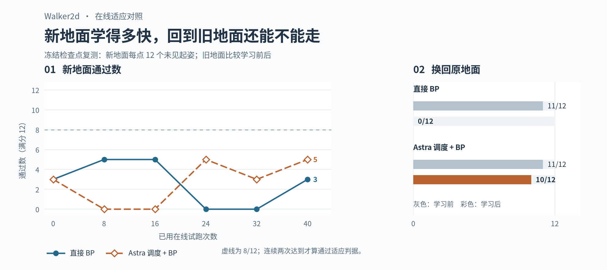

# Walker2d · 从已有步态出发

| 实验 | 看什么 | 实录 |
| --- | --- | --- |
| [首次直接改权重](neural-surgery-pilot/) | 两处编辑没救回失稳，原步态也受损 | [失稳起姿](neural-surgery-pilot/pilot-replay.mp4) |
| [只在将摔时修正](neural-surgery-round2/) | 改动更偏向危险状态，但指定起姿仍摔 | [失稳](neural-surgery-round2/target-replay.mp4) · [原起姿](neural-surgery-round2/nominal-replay.mp4) |
| [教师辅助 BP](neural-surgery-bp/) | 未见困难起姿 12/12；未见近原起姿由 11/12 降为 8/12 | [失稳](neural-surgery-bp/target-replay.mp4) · [原起姿](neural-surgery-bp/nominal-replay.mp4) |
| [先干预内部特征，再改权重](neural-surgery-probes/) | 救回指定失稳起姿；未见困难 5/12，未见近原 3/12 | [失稳](neural-surgery-probes/target-replay.mp4) · [原起姿](neural-surgery-probes/nominal-replay.mp4) |
| [换地面在线 BP](walker-online-bp/) | 两组均未稳定适应；回到旧地面，Astra 调度组 10/12、直接 BP 0/12 | [学习曲线](walker-online-bp/learning-curves.png) |

各目录保留冻结测试结果、主要实验源码和小型权重补丁。离线脚本可把 `experiments/walk` 和 `neural-surgery-pilot` 加入 `PYTHONPATH`；依赖见 [Walker2d 环境](../walk/README.md)。这里归档的是已经跑过的回放和数据，不含实验室的 SDK 调度配置。
